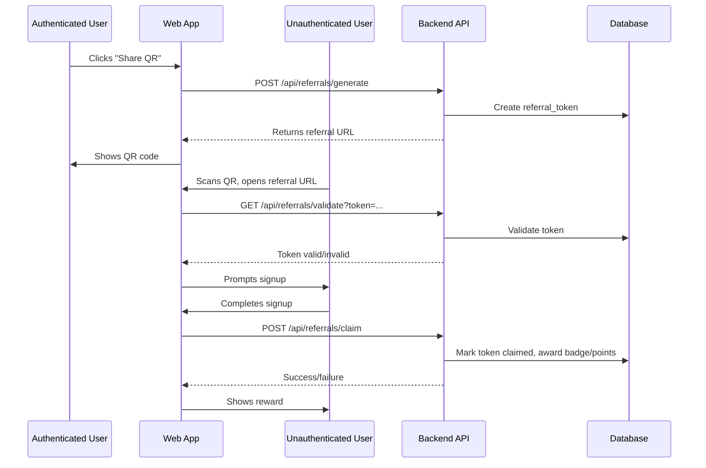
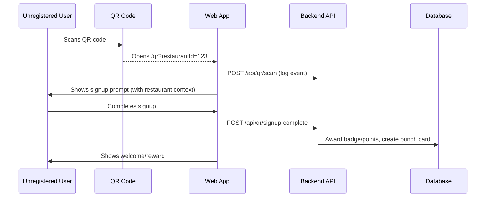

<!-- Generated by SpecStory -->

# Qr code system architecture and implementation plan (2025-06-02 03:36Z)

_**User**_


## QR Code System Architecture: Authentication Flow & State Management

### Part 1: Current State Analysis
**Document the existing QR code scan functionality from an authenticated app user's perspective, including:**
- Current scan-to-action workflows
- Data captured during scans
- State management approach
- Badge/reward system integration
- Technical architecture (APIs, data flow, storage)

### Part 2: Implementation Plan Request
**Design a comprehensive architecture for the following user journey:**

**Scenario:** Unauthenticated user scans a QR code generated by an authenticated app user

**Required Flow:**
1. **QR Code Generation** (by authenticated user)
   - What data should be encoded?
   - How to generate unique, trackable identifiers?

2. **Scan by Unauthenticated User**
   - Cross-platform detection (various QR readers)
   - Redirect to web application signup page

3. **State Preservation**
   - Maintain scan context through signup process
   - Temporary token/ID system for tracking
   - Security considerations for state management

4. **Signup Completion & Reward**
   - Successful account creation triggers
   - First restaurant badge fulfillment
   - Data reconciliation between scan and new account

### Part 3: Technical Requirements
**Address these architectural considerations:**
- URL structure and parameter handling
- Token expiration and security
- Cross-platform compatibility
- Error handling and edge cases
- Analytics and tracking requirements
- Database schema implications

**Deliverable:** Step-by-step implementation plan with technical specifications, API endpoints, and data flow diagrams.


---

_**Assistant**_

Here’s a comprehensive analysis and implementation plan for the QR code system, focusing on both the current authenticated-user flow and the requested unauthenticated-user referral journey. This is structured for clarity and direct use by another senior engineer or AI agent.

---

# QR Code System Architecture: Current State & Referral Flow

---

## Part 1: **Current State Analysis**

### 1. **Scan-to-Action Workflow**

**Actors:**  
- Authenticated app user (User, Restaurant Admin, System Admin)

**Flow:**
1. **User opens QR scanner** (`NavScanner` component).
2. **Scans QR code** (typically restaurant-specific, e.g., `/restaurants/:id/scan`).
3. **`handleScan`** in `NavScanner` calls `processQrScan` server action with `{ qrData, userId }`.
4. **Server Action (`processQrScan`)**:
   - Parses QR data, extracts restaurant ID.
   - Resolves user (by Clerk ID or DB ID).
   - Checks/creates punch card, increments punches.
   - If punch card completes, creates raffle entry.
   - Returns result object: `{ message, data, restaurantName, isExisting, success }`.
5. **Client State:**
   - `result` state holds server response.
   - UI displays success/failure, badge, and triggers redirect after delay.

**APIs Involved:**
- `/api/restaurants/[id]/scan` (for direct API)
- `processQrScan` (server action, used by client)
- DB models: `users`, `restaurants`, `punch_cards`, `raffle_entries`

---

### 2. **Data Captured During Scans**
- **QR Data:** Encoded URL or JSON (e.g., `/restaurants/123/scan`)
- **User ID:** From session/context
- **Restaurant ID:** Parsed from QR
- **Punch Card State:** Created or incremented
- **Raffle Entry:** Created if punch card completes
- **Analytics:** (Not fully shown, but can be logged at each step)

---

### 3. **State Management Approach**
- **Client:** React state (`useState` for `result`, `pause`, etc.)
- **Server:** Stateless, all state persisted in DB (punch cards, raffle entries)
- **Navigation:** Uses Next.js router to redirect after scan
- **Feedback:** UI shows spinner, then result (success/failure, badge, etc.)

---

### 4. **Badge/Reward System Integration**
- **Punch Card Completion:** Triggers raffle entry creation
- **Achievements:** (Planned for point transfers, milestones, etc.)
- **UI Feedback:** Success message, badge icon, redirect to profile/raffle

---

### 5. **Technical Architecture**
- **Frontend:** Next.js, React, Framer Motion, Tailwind, Clerk
- **Backend:** Next.js API routes, Drizzle ORM, Supabase (Postgres)
- **QR Scanning:** `@yudiel/react-qr-scanner` (browser camera)
- **Data Flow:**  
  - QR scan → client action → server action → DB → response → UI update
- **Storage:** All persistent state in Postgres via Drizzle ORM

---

## Part 2: **Referral Flow Implementation Plan**

### **Scenario:**  
*Unauthenticated user scans a QR code generated by an authenticated app user (referral/guest badge system).*

---

### **1. QR Code Generation (by Authenticated User)**

#### **Data to Encode**
- **Referral URL**:  
  `/referral?referrerId=<userId>&restaurantId=<restaurantId>&token=<secureToken>`
- **Fields:**
  - `referrerId`: The authenticated user's unique ID (Clerk or DB)
  - `restaurantId`: The restaurant context (optional, for targeted rewards)
  - `token`: A signed, time-limited JWT or random UUID (for security/tracking)

#### **How to Generate**
- **On demand** (e.g., "Share QR" button in app)
- **Backend endpoint**:  
  - `POST /api/referrals/generate`
  - Payload: `{ referrerId, restaurantId }`
  - Returns: `{ url, token, expiresAt }`
- **Token Generation:**
  - Use JWT or random UUID, store in `referral_tokens` table with metadata and expiration

#### **Example QR Data**
```
https://app.example.com/referral?referrerId=123&restaurantId=456&token=abcdef
```

---

### **2. Scan by Unauthenticated User**

#### **Cross-Platform Detection**
- QR code can be scanned by any QR reader (native camera, 3rd party app, etc.)
- **URL opens in browser** (mobile or desktop)

#### **Redirect to Signup**
- `/referral` route detects unauthenticated user
- Prompts: "Sign up to claim your reward from <referrer/restaurant>!"
- After signup, context is preserved (see next section)

---

### **3. State Preservation**

#### **Maintain Scan Context**
- **Referral token and params** are passed as URL query params
- On landing, store in:
  - **Session/localStorage** (for multi-step signup)
  - **Next.js server session** (if using server-side auth)
- **Token/ID system:**
  - `referral_tokens` table: `{ token, referrerId, restaurantId, createdAt, expiresAt, claimedByUserId, status }`
  - Mark as "claimed" after signup

#### **Security Considerations**
- **Token expiration** (e.g., 24h)
- **Single-use**: Mark as claimed after use
- **Validation**: On signup completion, verify token is valid, not expired, not already claimed
- **No sensitive data** in token (use server-side lookup)

---

### **4. Signup Completion & Reward**

#### **Trigger on Account Creation**
- After successful signup, check for referral context (token in session)
- **Backend endpoint**:  
  - `POST /api/referrals/claim`
  - Payload: `{ token, newUserId }`
  - Validates and marks referral as claimed

#### **Badge Fulfillment**
- Award "First Restaurant" badge or points to new user
- Optionally, reward referrer (e.g., bonus points, achievement)
- **DB updates:**
  - `achievements` table: add badge for new user
  - `point_balances` or `achievements`: update for referrer

#### **Data Reconciliation**
- Link referral record to new user
- Analytics: log conversion, source, etc.

---

## Part 3: **Technical Requirements & Specifications**

### **A. URL Structure & Parameter Handling**
- `/referral?referrerId=...&restaurantId=...&token=...`
- All params required for tracking and validation
- Use Next.js dynamic route: `/app/referral/page.tsx`

### **B. Token Expiration & Security**
- **JWT** (signed, expiring) or random UUID (stored in DB)
- Expire after 24h (configurable)
- Mark as claimed after use
- Validate on every use (signup, claim)

### **C. Cross-Platform Compatibility**
- QR code encodes HTTPS URL
- Works with any QR reader/camera
- Mobile-first design for landing/signup

### **D. Error Handling & Edge Cases**
- **Invalid/expired token:** Show error, prompt to sign up without reward
- **Already claimed:** Inform user, allow normal signup
- **Missing params:** Show generic error
- **Signup abandoned:** Token remains unclaimed until expiration

### **E. Analytics & Tracking**
- Log:
  - QR code generation (who, when, where)
  - Scan events (IP, device, timestamp)
  - Signup completions (conversion rate)
  - Badge/point fulfillment
- Use Supabase or external analytics (e.g., Vercel Analytics)

### **F. Database Schema Implications**

#### **New Table: `referral_tokens`**
```typescript
export const referralTokens = pgTable("referral_tokens", {
  id: serial("id").primaryKey(),
  token: text("token").notNull().unique(),
  referrerId: integer("referrer_id").references(() => users.id),
  restaurantId: integer("restaurant_id").references(() => restaurants.id),
  createdAt: timestamp("created_at").defaultNow(),
  expiresAt: timestamp("expires_at"),
  claimedByUserId: integer("claimed_by_user_id").references(() => users.id),
  status: text("status").notNull().default("active"), // active, claimed, expired
});
```

#### **API Endpoints**
- `POST /api/referrals/generate` – Authenticated, returns referral URL/token
- `GET /api/referrals/validate?token=...` – Validates token (for landing page)
- `POST /api/referrals/claim` – On signup, claims reward

---

## **Step-by-Step Implementation Plan**

### **1. QR Code Generation**
- Add "Share QR" button for authenticated users
- On click, call `POST /api/referrals/generate`
- Backend creates token, stores in `referral_tokens`, returns URL
- Frontend generates QR code with returned URL

### **2. Referral Landing Page**
- New Next.js route: `/app/referral/page.tsx`
- On load, parse query params, call `/api/referrals/validate`
- If valid, prompt signup; else, show error

### **3. State Preservation**
- On landing, store token/context in localStorage/session
- During signup, pass token/context through steps (or use server session)

### **4. Signup Completion**
- On successful signup, call `/api/referrals/claim` with token and new user ID
- Backend validates, marks referral as claimed, awards badge/points

### **5. Badge/Reward Fulfillment**
- Update `achievements` and/or `point_balances` for new user (and referrer)
- Show confirmation UI

### **6. Analytics**
- Log all relevant events (QR generation, scan, signup, claim)

---

## **Data Flow Diagram**



---

## **Summary Table: Key Endpoints & Data**

| Endpoint                       | Method | Purpose                        | Auth Required | Params/Body                |
|------------------------------- |--------|------------------------------- |--------------|---------------------------|
| `/api/referrals/generate`      | POST   | Generate referral QR/token     | Yes          | `{referrerId, restaurantId}` |
| `/api/referrals/validate`      | GET    | Validate referral token        | No           | `token` (query)           |
| `/api/referrals/claim`         | POST   | Claim referral after signup    | Yes (new user)| `{token, newUserId}`      |

---

## **Security & Best Practices**
- Use signed tokens (JWT or UUID + DB)
- Expire tokens after short period (24h)
- Mark tokens as claimed after use
- Never expose sensitive data in QR/URL
- Validate all params server-side
- Log all actions for audit/analytics

---

## **Edge Cases & Error Handling**
- Expired/invalid token: Show error, allow normal signup
- Already claimed: Inform, allow normal signup
- Multiple signups with same token: Only first gets reward
- Abandoned signup: Token remains active until expiration

---

## **Analytics & Tracking**
- Track QR generation, scans, signups, claims
- Store in `referral_tokens` and analytics tables
- Use for campaign effectiveness, fraud detection, reward optimization

---

## **Database Schema Changes**
- Add `referral_tokens` table (see above)
- Update `achievements` and `point_balances` logic for referral rewards

---

## **Next Steps**
- Implement backend endpoints and DB schema
- Build frontend QR generation and referral landing/signup flows
- Integrate with existing badge/reward system
- Add analytics and error handling

---

**This plan provides a robust, secure, and extensible architecture for QR-based referrals, supporting both authenticated and unauthenticated user flows, with clear state management, security, and analytics.** If you need code samples or further breakdowns for any step, let me know!

---

_**User**_

OK, we need to update part two of the documentation, the referral flow implementation plan. This is not a referral flow, this is for the use case when a stranger (could be anyone in the world) sees a QR code on the dinner table at the restaurant that they are visiting and they're like "oh, what's this?" The QR code and the requisite logic in the application must be able to support guiding anyone who's not a registered app user to become a registered app user if they scan a QR code in a participating restaurant. 

---

_**Assistant**_

Absolutely—let’s clarify and update the implementation plan for the **public QR onboarding flow** (not a referral, but a general “join the app” experience for any unregistered user who scans a restaurant’s QR code).

---

# Part 2 (Revised): **Public QR Onboarding Flow Implementation Plan**

## **Scenario**
A non-app-user (stranger/guest) scans a QR code displayed at a participating restaurant. The system should:
- Recognize the scan as coming from a public QR code (not a referral or user-generated code).
- Guide the user to sign up for the app, preserving the context of which restaurant’s QR code was scanned.
- Upon signup, optionally grant a “first visit” badge, points, or other onboarding reward, and associate the user with the restaurant for analytics or engagement.

---

## **Step-by-Step Implementation Plan**

### **1. QR Code Generation & Placement**

#### **What Data Should Be Encoded?**
- **URL format:**  
  ```
  https://app.example.com/qr?restaurantId=<restaurantId>&campaign=<optional>
  ```
  - `restaurantId`: Unique identifier for the restaurant.
  - `campaign`: (Optional) For tracking special promotions.

#### **How to Generate?**
- **Admin dashboard**: Restaurant admins or system admins generate QR codes for each location.
- **Backend endpoint**:  
  - `GET /api/qr/generate?restaurantId=...`
  - Returns a QR code image (PNG/SVG) encoding the above URL.
- **Physical placement**: Print and place QR codes on tables, menus, posters, etc.

---

### **2. Scan by Unregistered User**

#### **Cross-Platform Detection**
- Any QR reader (native camera, 3rd party app) opens the encoded URL in a browser.

#### **Landing Page Logic**
- **Route:** `/qr` (Next.js page)
- **Behavior:**
  - If user is **not authenticated**:
    - Show a branded landing page:  
      “Welcome to [App Name]! You scanned a code at [Restaurant Name]. Sign up to start earning rewards.”
    - Prominent **Sign Up** and **Sign In** buttons.
    - Store `restaurantId` (and `campaign` if present) in localStorage, session, or as a query param for the signup flow.
  - If user is **already authenticated**:
    - Optionally, redirect to punch card for that restaurant or show a “Welcome back!” message.

---

### **3. State Preservation Through Signup**

#### **How to Maintain Context?**
- **Store `restaurantId` and `campaign`**:
  - In localStorage/sessionStorage (client-side)
  - Or as a query param passed through the signup flow
- **Signup flow** (Clerk or custom):
  - On successful signup, check for stored `restaurantId`/`campaign` context.

#### **Security Considerations**
- No sensitive data in QR or URL.
- Validate `restaurantId` on backend before granting rewards.
- Optionally, set a short-lived cookie or session value for extra robustness.

---

### **4. Signup Completion & Reward**

#### **On Account Creation**
- **Backend logic** (triggered post-signup):
  - Check for `restaurantId` context.
  - Award “First Visit” badge, points, or other onboarding reward.
  - Optionally, create a punch card for the restaurant.
  - Log the event for analytics (user, restaurant, campaign, timestamp).

#### **Data Reconciliation**
- Link the new user to the restaurant for analytics.
- Optionally, send a welcome notification or email.

---

## **Technical Requirements & Specifications**

### **A. URL Structure & Parameter Handling**
- `/qr?restaurantId=123&campaign=spring2024`
- All params validated server-side.
- Use Next.js dynamic route: `/app/qr/page.tsx`

### **B. Token Expiration & Security**
- No sensitive tokens needed; only public IDs.
- Validate `restaurantId` exists and is active.
- Prevent abuse (e.g., rate limit badge/point grants per user).

### **C. Cross-Platform Compatibility**
- QR code encodes HTTPS URL.
- Works with any QR reader/camera.
- Mobile-first, responsive landing page.

### **D. Error Handling & Edge Cases**
- **Invalid/missing `restaurantId`**: Show error, allow generic signup.
- **Already signed up user scans**: Show punch card or “already a member” message.
- **Signup abandoned**: No reward granted until signup completes.

### **E. Analytics & Tracking**
- Log:
  - QR code scans (IP, device, timestamp, restaurant, campaign)
  - Signups from QR flow (conversion rate)
  - Badge/point fulfillment
- Use for campaign effectiveness, restaurant engagement, etc.

### **F. Database Schema Implications**

#### **No new tables required** (unless you want to track scans separately).  
- Optionally, add a `qr_signup_source` or `last_qr_scan_restaurant_id` field to the `users` table for attribution.
- Log events in an `analytics` or `qr_scan_events` table for deeper insights.

---

## **API Endpoints**

| Endpoint                       | Method | Purpose                        | Auth Required | Params/Body                |
|------------------------------- |--------|------------------------------- |--------------|---------------------------|
| `/api/qr/generate`             | GET    | Generate QR code for restaurant| Yes (admin)  | `restaurantId`, `campaign`|
| `/api/qr/scan`                 | POST   | Log scan event                 | No           | `{restaurantId, campaign, deviceInfo}`|
| `/api/qr/signup-complete`      | POST   | Award badge/points post-signup | Yes (new user)| `{restaurantId, campaign}`|

---

## **Data Flow Diagram**



---

## **Summary Table: Key Endpoints & Data**

| Endpoint                       | Method | Purpose                        | Auth Required | Params/Body                |
|------------------------------- |--------|------------------------------- |--------------|---------------------------|
| `/api/qr/generate`             | GET    | Generate QR code for restaurant| Yes (admin)  | `restaurantId`, `campaign`|
| `/api/qr/scan`                 | POST   | Log scan event                 | No           | `{restaurantId, campaign, deviceInfo}`|
| `/api/qr/signup-complete`      | POST   | Award badge/points post-signup | Yes (new user)| `{restaurantId, campaign}`|

---

## **Security & Best Practices**
- No sensitive data in QR/URL.
- Validate all params server-side.
- Prevent duplicate rewards for same user/restaurant.
- Log all actions for analytics.

---

## **Edge Cases & Error Handling**
- Invalid/missing `restaurantId`: Show error, allow generic signup.
- Already registered user: Show punch card or “already a member” message.
- Multiple signups from same device: Prevent abuse.

---

## **Analytics & Tracking**
- Track scans, signups, reward fulfillment.
- Attribute new users to restaurants/campaigns.

---

## **Database Schema Changes (Optional)**
- Add `qr_signup_source` to `users` table.
- Add `qr_scan_events` table for analytics.

---

## **Next Steps**
- Implement QR code generation and admin UI.
- Build `/qr` landing page and signup flow.
- Integrate reward logic post-signup.
- Add analytics and error handling.

---

**This plan ensures a seamless, secure, and trackable onboarding experience for any guest who scans a restaurant QR code, driving app adoption and engagement.**  
Let me know if you want code samples, DB migration scripts, or further breakdowns for any step!

---

_**User**_

Can  you create a step by step implementation plan and instructions to hand off to both AI and human software agents to complete the Part 2 (Revised): Public QR Onboarding Flow Implementation Plan feature? 

---

_**Assistant**_

<think><details><summary>Thought Process</summary>The user wants me to create a comprehensive step-by-step implementation plan that can be handed off to either AI agents or human software engineers. This needs to be very detailed, actionable, and include specific technical instructions, code examples, and clear acceptance criteria for each step.

Given my role as an Engineering Ticket Architect, I should break this down into discrete, manageable tickets that follow SOLID principles and provide clear implementation guidance. Each ticket should be 1-3 days of work and include all necessary context.

Let me structure this as a series of implementation tickets with:
1. Clear titles and descriptions
2. Detailed acceptance criteria
3. Implementation notes
4. Code samples/pseudocode
5. Testing requirements
6. Dependencies

I'll organize this chronologically based on the implementation flow.</details></think>

---

# Public QR Onboarding Flow - Implementation Plan & Handoff Documentation

---

## **Implementation Overview**

This plan breaks down the Public QR Onboarding Flow into discrete, actionable tickets suitable for handoff to AI agents or human developers. Each ticket represents 1-3 days of work and includes comprehensive implementation guidance.

---

## **Ticket 1: Database Schema Updates for QR Analytics**

### **Title:** Add QR scan tracking and user attribution schema

### **Description:**
Create database tables and schema modifications to support QR code analytics, user attribution, and scan event logging for the public onboarding flow.

### **Acceptance Criteria:**
- [ ] Create `qr_scan_events` table for analytics
- [ ] Add optional `signup_source` field to `users` table
- [ ] Create database migration scripts
- [ ] Update Drizzle schema definitions
- [ ] Add insert/select schemas with Zod validation

### **Implementation Notes:**

**Database Schema:**
```typescript
// Add to src/db/schema.ts
export const qrScanEvents = pgTable("qr_scan_events", {
  id: serial("id").primaryKey(),
  restaurantId: integer("restaurant_id").references(() => restaurants.id),
  campaign: text("campaign"),
  ipAddress: text("ip_address"),
  userAgent: text("user_agent"),
  deviceInfo: json("device_info").default({}),
  convertedToSignup: boolean("converted_to_signup").default(false),
  userId: integer("user_id").references(() => users.id), // Set after signup
  scannedAt: timestamp("scanned_at").defaultNow(),
});

// Modify existing users table
export const users = pgTable("users", {
  // ... existing fields ...
  signupSource: text("signup_source"), // 'qr', 'organic', 'referral', etc.
  signupRestaurantId: integer("signup_restaurant_id").references(() => restaurants.id),
});
```

**Zod Schemas:**
```typescript
// Add to appropriate model files
export const insertQrScanEventSchema = createInsertSchema(qrScanEvents).omit({
  id: true,
  scannedAt: true,
});

export const updateUserSignupSourceSchema = z.object({
  signupSource: z.enum(['qr', 'organic', 'referral']),
  signupRestaurantId: z.number().optional(),
});
```

### **Files to Create/Modify:**
- `src/db/schema.ts` - Add new table definitions
- `drizzle/migrations/` - New migration file
- `src/db/models/qr-analytics/qr-analytics.ts` - CRUD functions
- `src/db/models/users/users.ts` - Update user functions

### **Testing Requirements:**
- Verify migration runs successfully
- Test CRUD operations for new tables
- Validate Zod schemas

### **Dependencies:** None

---

## **Ticket 2: QR Code Generation API Endpoint**

### **Title:** Create QR code generation endpoint for restaurant admins

### **Description:**
Build API endpoint that allows restaurant admins and system admins to generate QR codes for their restaurants, with optional campaign parameters for tracking.

### **Acceptance Criteria:**
- [ ] Create `GET /api/qr/generate` endpoint
- [ ] Implement role-based authorization (Restaurant Admin + System Admin)
- [ ] Generate QR codes with restaurant-specific URLs
- [ ] Support optional campaign parameters
- [ ] Return QR code as base64 image or SVG
- [ ] Log QR generation events for analytics

### **Implementation Notes:**

**API Endpoint:**
```typescript
// src/app/api/qr/generate/route.ts
import { auth } from '@clerk/nextjs/server';
import { getRestaurantById } from '@/db/models/restaurants/restaurants';
import QRCode from 'qrcode'; // npm install qrcode @types/qrcode

export async function GET(request: Request) {
  const { userId } = auth();
  if (!userId) {
    return Response.json({ error: 'Unauthorized' }, { status: 401 });
  }

  const url = new URL(request.url);
  const restaurantId = url.searchParams.get('restaurantId');
  const campaign = url.searchParams.get('campaign') || '';

  // Validate restaurantId exists
  const restaurant = await getRestaurantById(BigInt(restaurantId));
  if (!restaurant) {
    return Response.json({ error: 'Restaurant not found' }, { status: 404 });
  }

  // TODO: Add role-based authorization check
  // Ensure user is admin or restaurant admin for this restaurant

  const qrUrl = `${process.env.NEXT_PUBLIC_APP_URL}/qr?restaurantId=${restaurantId}&campaign=${campaign}`;
  
  try {
    const qrCodeDataUrl = await QRCode.toDataURL(qrUrl, {
      width: 300,
      margin: 2,
    });

    // TODO: Log QR generation event

    return Response.json({
      success: true,
      qrCodeDataUrl,
      url: qrUrl,
      restaurant: restaurant.name,
      campaign,
    });
  } catch (error) {
    return Response.json({ error: 'Failed to generate QR code' }, { status: 500 });
  }
}
```

**Authorization Helper:**
```typescript
// src/lib/auth-helpers.ts
export async function validateRestaurantAdminAccess(
  userId: string, 
  restaurantId: bigint
): Promise<boolean> {
  // Implementation depends on your role system
  // Check if user is system admin OR restaurant admin for this restaurant
}
```

### **Files to Create/Modify:**
- `src/app/api/qr/generate/route.ts` - Main endpoint
- `src/lib/auth-helpers.ts` - Authorization utilities
- `package.json` - Add qrcode dependency

### **Testing Requirements:**
- Test with valid/invalid restaurant IDs
- Test authorization (admin vs non-admin)
- Verify QR code generation
- Test optional campaign parameter

### **Dependencies:** Ticket 1 (for logging)

---

## **Ticket 3: QR Landing Page with Restaurant Context**

### **Title:** Create public QR landing page for unauthenticated users

### **Description:**
Build the `/qr` landing page that welcomes unauthenticated users, displays restaurant context, and guides them to signup while preserving scan context.

### **Acceptance Criteria:**
- [ ] Create `/qr` page route
- [ ] Parse `restaurantId` and `campaign` from URL parameters
- [ ] Display restaurant information and branding
- [ ] Show compelling signup call-to-action
- [ ] Preserve context through signup flow
- [ ] Handle authenticated users appropriately
- [ ] Log scan events for analytics
- [ ] Mobile-responsive design

### **Implementation Notes:**

**Page Component:**
```typescript
// src/app/qr/page.tsx
import { Suspense } from 'react';
import { QrLandingContent } from '@/components/qr/qr-landing-content';

export default function QrLandingPage() {
  return (
    <div className="min-h-screen bg-gradient-to-br from-orange-50 to-red-50">
      <Suspense fallback={<div>Loading...</div>}>
        <QrLandingContent />
      </Suspense>
    </div>
  );
}
```

**Landing Content Component:**
```typescript
// src/components/qr/qr-landing-content.tsx
'use client';

import { useSearchParams, useRouter } from 'next/navigation';
import { useAuth } from '@clerk/nextjs';
import { useEffect, useState } from 'react';
import { getRestaurantById } from '@/db/models/restaurants/restaurants';
import { logQrScanEvent } from '@/actions/qr-actions';

export function QrLandingContent() {
  const searchParams = useSearchParams();
  const router = useRouter();
  const { isLoaded, isSignedIn } = useAuth();
  
  const restaurantId = searchParams.get('restaurantId');
  const campaign = searchParams.get('campaign') || '';
  
  const [restaurant, setRestaurant] = useState(null);
  const [loading, setLoading] = useState(true);

  useEffect(() => {
    if (!restaurantId) {
      router.push('/restaurants'); // Redirect if no restaurant context
      return;
    }

    // Log scan event
    logQrScanEvent({ restaurantId, campaign });

    // Fetch restaurant details
    // Implementation here...

    // Store context for signup flow
    localStorage.setItem('qr_signup_context', JSON.stringify({
      restaurantId,
      campaign,
      timestamp: Date.now(),
    }));
  }, [restaurantId, campaign]);

  // Handle authenticated users
  if (isLoaded && isSignedIn) {
    router.push(`/restaurants/${restaurantId}`);
    return null;
  }

  return (
    <div className="container mx-auto px-4 py-8">
      {/* Restaurant hero section */}
      {/* Signup CTA */}
      {/* Features/benefits */}
    </div>
  );
}
```

**Server Action for Logging:**
```typescript
// src/actions/qr-actions.ts
'use server';

import { createQrScanEvent } from '@/db/models/qr-analytics/qr-analytics';

export async function logQrScanEvent({
  restaurantId,
  campaign,
}: {
  restaurantId: string;
  campaign?: string;
}) {
  // Get request headers for device info
  // Log scan event to database
}
```

### **Files to Create/Modify:**
- `src/app/qr/page.tsx` - Main page route
- `src/components/qr/qr-landing-content.tsx` - Landing page component
- `src/actions/qr-actions.ts` - Server actions
- `src/db/models/qr-analytics/qr-analytics.ts` - Database functions

### **Testing Requirements:**
- Test with valid/invalid restaurant IDs
- Test authenticated vs unauthenticated users
- Verify context preservation
- Test mobile responsiveness

### **Dependencies:** Ticket 1, Ticket 2

---

## **Ticket 4: Signup Flow Context Preservation**

### **Title:** Modify signup flow to preserve and process QR scan context

### **Description:**
Update the existing Clerk signup flow to detect QR scan context, preserve it through the signup process, and trigger appropriate rewards upon successful account creation.

### **Acceptance Criteria:**
- [ ] Detect QR scan context in signup flow
- [ ] Preserve context through multi-step signup
- [ ] Create server action for post-signup processing
- [ ] Award "first visit" badge/points
- [ ] Update user record with signup source
- [ ] Link scan event to new user
- [ ] Handle edge cases and errors gracefully

### **Implementation Notes:**

**Signup Completion Hook:**
```typescript
// src/components/auth/signup-completion-handler.tsx
'use client';

import { useUser } from '@clerk/nextjs';
import { useEffect } from 'react';
import { processQrSignupCompletion } from '@/actions/qr-actions';

export function SignupCompletionHandler() {
  const { user, isLoaded } = useUser();

  useEffect(() => {
    if (!isLoaded || !user) return;

    // Check for QR signup context
    const qrContext = localStorage.getItem('qr_signup_context');
    if (!qrContext) return;

    try {
      const context = JSON.parse(qrContext);
      
      // Process QR signup completion
      processQrSignupCompletion({
        userId: user.id,
        restaurantId: context.restaurantId,
        campaign: context.campaign,
      });

      // Clear context
      localStorage.removeItem('qr_signup_context');
    } catch (error) {
      console.error('Error processing QR signup:', error);
    }
  }, [user, isLoaded]);

  return null;
}
```

**Server Action for Processing:**
```typescript
// Add to src/actions/qr-actions.ts
export async function processQrSignupCompletion({
  userId,
  restaurantId,
  campaign,
}: {
  userId: string;
  restaurantId: string;
  campaign?: string;
}) {
  try {
    // Get or create user in database
    const user = await getUserByClerkId(userId);
    if (!user) {
      throw new Error('User not found');
    }

    // Update user with signup source
    await updateUserSignupSource(user.id, {
      signupSource: 'qr',
      signupRestaurantId: BigInt(restaurantId),
    });

    // Award first visit badge/points
    await awardFirstVisitReward(user.id, BigInt(restaurantId));

    // Update scan event with user ID
    await linkScanEventToUser(user.id, BigInt(restaurantId), campaign);

    return { success: true };
  } catch (error) {
    console.error('QR signup completion error:', error);
    return { success: false, error: error.message };
  }
}
```

### **Files to Create/Modify:**
- `src/components/auth/signup-completion-handler.tsx` - New component
- `src/actions/qr-actions.ts` - Add server actions
- `src/app/layout.tsx` - Add SignupCompletionHandler
- `src/db/models/users/users.ts` - Add update functions

### **Testing Requirements:**
- Test signup with and without QR context
- Verify reward fulfillment
- Test edge cases (invalid context, etc.)
- Test context clearing

### **Dependencies:** Ticket 1, Ticket 3

---

## **Ticket 5: Admin QR Code Management Interface**

### **Title:** Build admin dashboard interface for QR code generation and management

### **Description:**
Create admin dashboard components that allow restaurant admins and system admins to generate, view, and manage QR codes for their restaurants.

### **Acceptance Criteria:**
- [ ] Add QR code management section to admin dashboard
- [ ] QR code generation form with restaurant and campaign inputs
- [ ] Display generated QR codes with download options
- [ ] Show QR code analytics (scans, conversions)
- [ ] Support bulk QR generation for multiple campaigns
- [ ] Responsive design for mobile/desktop

### **Implementation Notes:**

**Admin QR Management Page:**
```typescript
// src/app/admin/qr-codes/page.tsx
import { QrCodeManagement } from '@/components/admin/qr/qr-code-management';

export default function AdminQrCodesPage() {
  return (
    <div className="container mx-auto py-8">
      <h1 className="text-3xl font-bold mb-8">QR Code Management</h1>
      <QrCodeManagement />
    </div>
  );
}
```

**QR Management Component:**
```typescript
// src/components/admin/qr/qr-code-management.tsx
'use client';

import { useState } from 'react';
import { Button } from '@/components/ui/button';
import { Input } from '@/components/ui/input';
import { Select } from '@/components/ui/select';
import { Card } from '@/components/ui/card';

export function QrCodeManagement() {
  const [selectedRestaurant, setSelectedRestaurant] = useState('');
  const [campaign, setCampaign] = useState('');
  const [generatedQr, setGeneratedQr] = useState(null);
  const [loading, setLoading] = useState(false);

  const handleGenerateQr = async () => {
    setLoading(true);
    try {
      const response = await fetch(
        `/api/qr/generate?restaurantId=${selectedRestaurant}&campaign=${campaign}`
      );
      const data = await response.json();
      
      if (data.success) {
        setGeneratedQr(data);
      }
    } catch (error) {
      console.error('Error generating QR:', error);
    } finally {
      setLoading(false);
    }
  };

  return (
    <div className="space-y-6">
      {/* Generation form */}
      <Card className="p-6">
        <h2 className="text-xl font-semibold mb-4">Generate New QR Code</h2>
        {/* Form fields */}
        <Button onClick={handleGenerateQr} disabled={loading}>
          Generate QR Code
        </Button>
      </Card>

      {/* Generated QR display */}
      {generatedQr && (
        <Card className="p-6">
          <h3 className="text-lg font-semibold mb-4">Generated QR Code</h3>
          {/* QR code display and download options */}
        </Card>
      )}

      {/* Analytics section */}
      <Card className="p-6">
        <h3 className="text-lg font-semibold mb-4">QR Code Analytics</h3>
        {/* Analytics charts and metrics */}
      </Card>
    </div>
  );
}
```

### **Files to Create/Modify:**
- `src/app/admin/qr-codes/page.tsx` - Admin page
- `src/components/admin/qr/qr-code-management.tsx` - Main component
- `src/components/admin/qr/qr-analytics-chart.tsx` - Analytics component
- `src/components/nav/nav.tsx` - Add admin nav link

### **Testing Requirements:**
- Test QR generation with different restaurants
- Verify download functionality
- Test role-based access
- Test responsive design

### **Dependencies:** Ticket 2

---

## **Ticket 6: QR Analytics and Reporting**

### **Title:** Implement QR scan analytics and conversion tracking

### **Description:**
Build analytics dashboard and reporting functionality to track QR code performance, conversion rates, and user acquisition metrics.

### **Acceptance Criteria:**
- [ ] Create analytics API endpoints for QR metrics
- [ ] Build analytics dashboard components
- [ ] Track conversion funnel (scan → signup → first action)
- [ ] Generate reports by restaurant and campaign
- [ ] Real-time metrics display
- [ ] Export functionality for reports

### **Implementation Notes:**

**Analytics API:**
```typescript
// src/app/api/qr/analytics/route.ts
export async function GET(request: Request) {
  const url = new URL(request.url);
  const restaurantId = url.searchParams.get('restaurantId');
  const startDate = url.searchParams.get('startDate');
  const endDate = url.searchParams.get('endDate');

  // Query QR scan events and calculate metrics
  const analytics = await getQrAnalytics({
    restaurantId: restaurantId ? BigInt(restaurantId) : undefined,
    startDate: startDate ? new Date(startDate) : undefined,
    endDate: endDate ? new Date(endDate) : undefined,
  });

  return Response.json(analytics);
}
```

**Analytics Functions:**
```typescript
// src/db/models/qr-analytics/qr-analytics.ts
export async function getQrAnalytics({
  restaurantId,
  startDate,
  endDate,
}: {
  restaurantId?: bigint;
  startDate?: Date;
  endDate?: Date;
}) {
  // Calculate:
  // - Total scans
  // - Unique users
  // - Conversion rate (scan → signup)
  // - Top performing campaigns
  // - Daily/weekly trends
}
```

### **Files to Create/Modify:**
- `src/app/api/qr/analytics/route.ts` - Analytics API
- `src/db/models/qr-analytics/qr-analytics.ts` - Analytics functions
- `src/components/admin/qr/qr-analytics-dashboard.tsx` - Dashboard component
- `src/hooks/use-qr-analytics.ts` - Analytics hook

### **Testing Requirements:**
- Test analytics calculations
- Verify filtering by restaurant/date
- Test real-time updates
- Validate export functionality

### **Dependencies:** Ticket 1, Ticket 4

---

## **Ticket 7: Integration Testing and Error Handling**

### **Title:** Comprehensive testing and error handling for QR onboarding flow

### **Description:**
Implement comprehensive error handling, edge case management, and integration testing for the complete QR onboarding flow.

### **Acceptance Criteria:**
- [ ] Handle invalid/expired QR codes gracefully
- [ ] Implement rate limiting for QR generation
- [ ] Add comprehensive error boundaries
- [ ] Create integration tests for complete flow
- [ ] Add monitoring and alerting
- [ ] Performance optimization
- [ ] Security audit and fixes

### **Implementation Notes:**

**Error Handling:**
```typescript
// src/lib/qr-error-handling.ts
export class QrFlowError extends Error {
  constructor(
    message: string,
    public code: string,
    public statusCode: number = 400
  ) {
    super(message);
    this.name = 'QrFlowError';
  }
}

export function handleQrError(error: unknown) {
  if (error instanceof QrFlowError) {
    return {
      error: error.message,
      code: error.code,
      statusCode: error.statusCode,
    };
  }
  
  console.error('Unexpected QR flow error:', error);
  return {
    error: 'An unexpected error occurred',
    code: 'INTERNAL_ERROR',
    statusCode: 500,
  };
}
```

**Integration Tests:**
```typescript
// tests/qr-flow.test.ts
describe('QR Onboarding Flow', () => {
  test('Complete flow: generate → scan → signup → reward', async () => {
    // Test complete user journey
  });

  test('Invalid restaurant ID handling', async () => {
    // Test error cases
  });

  test('Authenticated user scanning QR', async () => {
    // Test redirect behavior
  });
});
```

### **Files to Create/Modify:**
- `src/lib/qr-error-handling.ts` - Error handling utilities
- `tests/qr-flow.test.ts` - Integration tests
- `src/middleware.ts` - Rate limiting
- All QR-related files - Add error handling

### **Testing Requirements:**
- Complete integration test suite
- Error scenario testing
- Performance testing
- Security testing

### **Dependencies:** All previous tickets

---

## **Implementation Order & Timeline**

| Ticket | Estimated Time | Dependencies | Priority |
|--------|---------------|--------------|----------|
| 1      | 1 day         | None         | High     |
| 2      | 2 days        | 1            | High     |
| 3      | 2 days        | 1, 2         | High     |
| 4      | 2 days        | 1, 3         | High     |
| 5      | 2 days        | 2            | Medium   |
| 6      | 2 days        | 1, 4         | Medium   |
| 7      | 3 days        | All          | High     |

**Total Estimated Time:** 14 days

---

## **Handoff Checklist**

### **For AI Agents:**
- [ ] All code examples are complete and executable
- [ ] Database schemas include full TypeScript definitions
- [ ] API endpoints have complete request/response types
- [ ] Error handling patterns are clearly defined
- [ ] Testing requirements are specific and measurable

### **For Human Developers:**
- [ ] Business context and user journey are clearly explained
- [ ] Technical decisions are justified
- [ ] Integration points with existing code are identified
- [ ] Security considerations are documented
- [ ] Performance requirements are specified

### **Prerequisites:**
- Existing authentication system (Clerk)
- Database setup (Drizzle + Supabase)
- Admin dashboard foundation
- Basic component library (shadcn/ui)

### **Environment Variables Required:**
```env
NEXT_PUBLIC_APP_URL=https://your-app.com
# Existing auth and database vars
```

### **Dependencies to Install:**
```bash
npm install qrcode @types/qrcode
```

---

## **Success Metrics**

- [ ] QR codes can be generated by admins
- [ ] Unregistered users can scan and sign up
- [ ] Context is preserved through signup
- [ ] Rewards are granted appropriately
- [ ] Analytics track conversion funnel
- [ ] Error handling covers edge cases
- [ ] Performance meets requirements (<2s load times)

---

**This implementation plan provides a complete, production-ready QR onboarding system that can be executed by either AI or human developers with clear guidance and measurable outcomes.**

---

